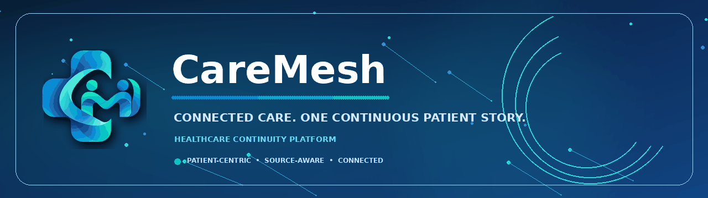
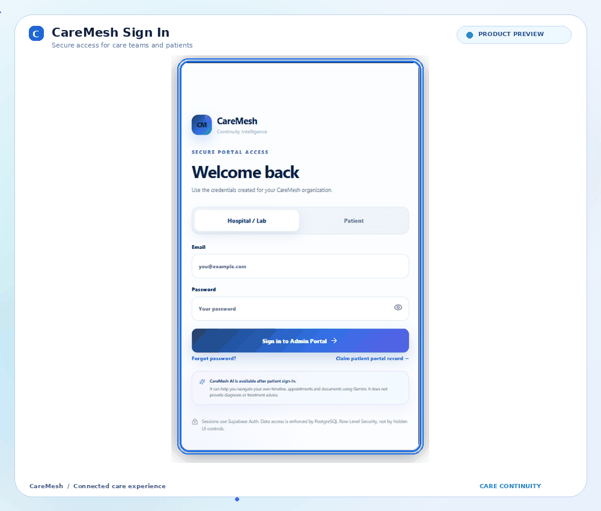
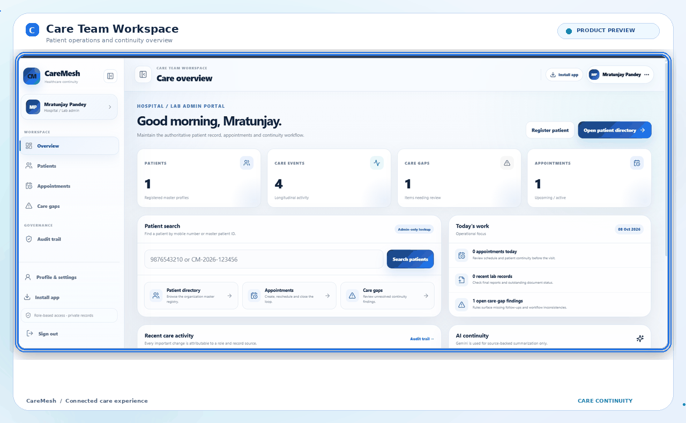
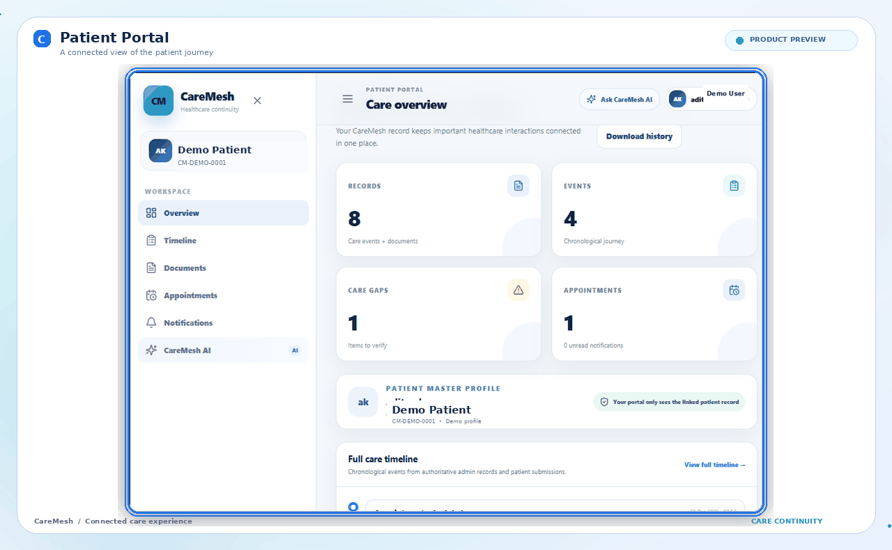
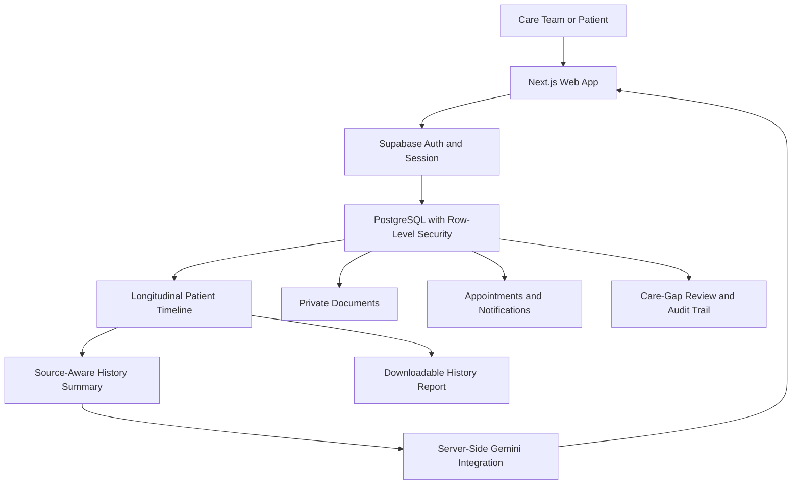
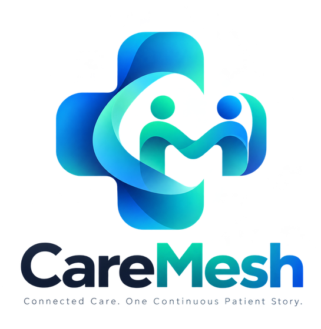

<p align="center">
  
</p>

<p align="center">
  <a href="https://caremesh-green.vercel.app/"></a>
  
  
  
</p>

<h3 align="center">Connected care. One continuous patient story.</h3>

<p align="center">
  CareMesh is a healthcare continuity platform that brings relevant patient records, documents, appointments, notifications, and follow-up information into one connected experience for healthcare teams and patients.
</p>

---

## ✨ What is CareMesh?

Healthcare information can become fragmented across visits, documents, schedules, and separate workflows. **CareMesh is designed to make the journey easier to follow** by connecting relevant information to a longitudinal patient timeline.

The platform has two role-aware experiences:

- **Care Team / Hospital & Lab Portal** — supports organization-scoped patient administration, clinical record management, appointments, documents, care-gap review, and audit visibility.
- **Patient Portal** — gives each patient access to their own linked record, timeline, documents, appointments, notifications, profile, and the CareMesh AI assistant.

CareMesh focuses on **continuity, information organization, traceability, and coordination**. It is not an autonomous diagnosis or treatment system.

## 🎬 CareMesh UI — animated previews

The previews below use real CareMesh application screenshots, framed with subtle animated gradients, glowing outlines, and motion effects for a more engaging GitHub README. Patient demo identifiers are replaced with generic showcase values.

### 1. Secure sign-in

<p align="center">
  
</p>

The sign-in screen separates the Hospital / Lab and Patient access paths and provides entry points for password recovery and patient portal access.

### 2. Care team / admin dashboard

<p align="center">
  
</p>

The care team workspace provides a summary of patient activity, care events, outstanding care gaps, appointments, patient search, and operational shortcuts.

### 3. Patient dashboard

<p align="center">
  
</p>

The patient dashboard presents a single view of recorded events, documents, upcoming appointments, notifications, relevant care gaps, and the longitudinal timeline.

## 🚀 Core features

### 🏥 Care team workspace

- Organization-scoped care team dashboard.
- Patient directory and patient registration.
- Patient lookup by mobile number or master patient ID.
- Clinical and care records organized against the patient journey, including supported visit, admission, lab, follow-up, appointment, billing, and document activity.
- Appointment lifecycle management.
- Patient portal invitations and clinician/team management.
- Document review and authorized downloads.
- Care-gap findings with review and resolution workflows.
- Audit trail for important activity.
- Source-aware history summaries and downloadable patient reports.

### 👤 Patient portal

- Own-record access for the authenticated, linked patient.
- Longitudinal timeline for relevant events.
- Document list and patient document uploads.
- Appointment details and booking workflows.
- Notifications and continuity reminders.
- Patient profile and account settings.
- Downloadable patient history report.
- Responsive desktop and mobile navigation.
- Installable Progressive Web App (PWA) experience where supported by the browser.

### 🧠 CareMesh AI — continuity support

CareMesh integrates Google Gemini through server-side endpoints for selected history-summary and patient-assistant workflows.

The assistant is intended to help users:

- Summarize documented timeline events.
- Review available records, documents, and appointment information.
- Find source-backed continuity information within the linked record.
- Understand administrative next steps reflected in recorded information.

**AI safety boundary:** CareMesh AI is not a medical professional. It must not diagnose conditions, prescribe medication, recommend treatment, or replace clinical judgement. AI responses are intended for information review and continuity support, and should be checked against source records and professional guidance when appropriate.

### 📄 Records, reports, and traceability

- Chronological patient timeline.
- Separate treatment of clinical-team records and patient-submitted documents.
- PDF history reports generated from available record information.
- Audit visibility for important actions.
- Private document storage with authorized access paths.
- Care-gap rules that highlight items for review instead of making medical decisions.

## 🧭 How CareMesh works

1. **Authenticate and establish role** — Supabase Auth identifies the user. Organization membership and patient linkage determine the relevant portal and data scope.
2. **Load authorized information** — server-side data access and PostgreSQL Row-Level Security (RLS) enforce the relevant access boundary.
3. **Connect care events** — clinical activity, appointments, documents, and follow-up information are represented as a chronological patient journey.
4. **Coordinate next actions** — care teams can review appointments, documents, and care-gap findings; patients can view their available information and upcoming events.
5. **Summarize with context** — the AI layer receives the relevant authenticated record context for supported continuity tasks. It does not act as a diagnostic engine.
6. **Keep a record trail** — important actions can be auditable, and supported reports provide a readable view of recorded history.



## 🧱 Tech stack

| Layer | Technologies | Purpose |
|---|---|---|
| Web framework | **Next.js 16 App Router** | Server-rendered application, route handlers, and server-side workflows |
| UI | **React 19, TypeScript** | Type-safe, component-based interface |
| Styling | **CSS** | Responsive layouts, application shell, cards, forms, and visual states |
| Authentication | **Supabase Auth**, `@supabase/ssr` | Authenticated sessions and server/browser Supabase clients |
| Database | **Supabase PostgreSQL** | Patients, care events, appointments, and application records |
| Authorization | **PostgreSQL Row-Level Security (RLS)** | Database-enforced organization and patient data boundaries |
| File storage | **Supabase Storage** | Private patient document storage and authorized document access |
| AI | **Google Gemini API** | Record-focused history summaries and patient continuity assistant |
| PDF reporting | **pdf-lib** | Downloadable history reports |
| UI utilities | **Lucide React, Sonner** | Consistent icons and toast notifications |
| Data validation | **Zod** | Input and request validation in supported flows |
| Date handling | **date-fns** | Date formatting and date-related utilities |
| Installable web app | **PWA manifest and service worker** | Browser-supported app installation and offline shell experience |

## 🔐 Security and privacy principles

CareMesh is designed around server-side access control and explicit data scope:

- **RLS is the data authorization boundary**; frontend visibility alone is not treated as security.
- Patient access is limited to the linked patient record.
- Care team access is scoped to the relevant organization and role.
- Medical documents are held in a private storage bucket and accessed through authorized flows.
- Supabase service-role credentials and Gemini API credentials remain on the server and must never be exposed to browser code.
- Authenticated healthcare pages are not intended to be written to the service worker's offline cache.
- AI output remains separate from authoritative clinical records and must not be treated as diagnosis or treatment.

Security depends on the deployed database policies, environment configuration, and operational practices as well as application code; no platform should be assumed secure without appropriate review and testing.

## 🗂️ Project structure

```text
app/
  admin/                     Care team and hospital/lab portal
  patient/                   Patient portal
  api/                       AI, documents, reports, and other server endpoints
  login/                     Authentication UI
  profile/                   Profile and settings
components/                  Shared application shell and UI components
lib/
  supabase/                  Supabase server, client, and admin integrations
  auth.ts                    Authentication and authorization helpers
  audit.ts                   Audit-related utilities
  care-gaps.ts               Care-gap rule logic
  gemini.ts                  Server-side AI integration
public/                      PWA manifest, icons, service worker, offline shell
scripts/                     Administrative provisioning utility
supabase/                    Database migrations and policy/permission patches
assets/                      README preview artwork and screenshots
```

## 📱 Responsive experience

CareMesh includes responsive layouts for desktop and mobile. The application shell adapts navigation for smaller screens, and the patient-facing timeline, documents, appointments, and AI assistant are designed to remain usable on phone-sized viewports. Browser installation support is provided through the PWA manifest, icons, service worker, and install prompt where supported.

## 🎯 Product principles

- **One connected story:** relevant information is organized around the patient's journey.
- **Clear provenance:** team-authored records and patient-submitted material should remain distinguishable.
- **Least-privilege access:** users should only reach records that match their authorized role and relationship.
- **Human oversight:** AI organizes information; clinical decisions remain with qualified professionals.
- **Useful traceability:** reports, timelines, and audit information help people review what is recorded.

## ⚕️ Responsible-use notice

CareMesh is a software project for healthcare information continuity and coordination. It is not a substitute for professional medical advice, diagnosis, or treatment, and should not be used for emergencies. Demonstration screenshots and sample values are for product presentation; do not publish real patient data, credentials, API keys, or private clinical documents in public repositories.

---

<p align="center">
  
</p>

<p align="center"><b>CareMesh</b> · Connected Care. One Continuous Patient Story.</p>
